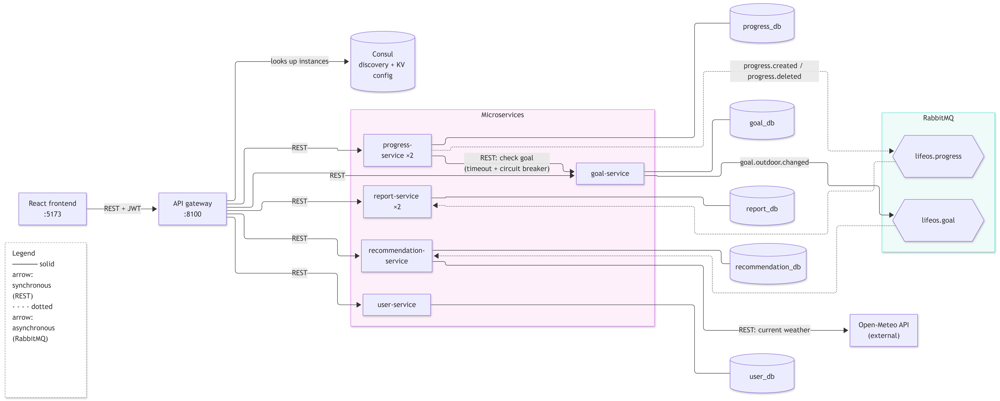

# LifeOS

LifeOS is a goal tracker. Users pick a goal from a catalog of templates (or create their own),
check in when they do it, and follow their progress over time with streaks,
completion rate and history.

It was built by a team of two as the portfolio project for PG3402 Microservices at Kristiania University College (autumn 2026).
The system is split into five Spring Boot microservices, each with its own PostgreSQL database,
behind a Spring Cloud Gateway with Consul for service discovery and configuration. Services talk
synchronously over REST and asynchronously through RabbitMQ.

**What a user can do:**

- Register and log in with email/password or Google
- Create custom goals or choose from premade templates, then archive or delete them (editing is available through the API)
- Track two kinds of goals: check-in goals (daily, weekly or monthly, e.g. "run 3× a week") and amount goals
  (e.g. "read 300 pages a month") with a running total and a pace marker
- Check in on today's goals and fix forgotten days (up to 2 days back, weekly and monthly goals back to the start of the period)
- See insights per goal: current streak, completion rate, last 30 days vs the 30 before, history per period,
  and an activity calendar of all check-ins
- Log mood and sleep for the day (Quick log on Today) and see the 30-day averages on Insights
- See a weather card on Today when they have an outdoor goal: current weather, a GOOD/OK/POOR rating for training outside,
  advice (e.g. "Wear shoes with good grip") and a better time of day if the weather improves later
- Get hints about how their goals fit together, on the Goals page and while creating a goal: goals that support each other
  ("Consider adding: Sleep 8 hours"), goals that pull against each other, goals that overlap, and too many daily goals

## Contents

- [Quick start](#quick-start)
  - [Other ways to run](#other-ways-to-run)
  - [Ports](#ports)
- [Test credentials and seed data](#test-credentials-and-seed-data)
- [Architecture](#architecture)
  - [Services](#services)
  - [Communication](#communication)
  - [Gateway, discovery, config, scaling](#gateway-discovery-config-scaling)
  - [Logging](#logging)
- [Tests and CI](#tests-and-ci)
- [User stories (how to test them)](#user-stories-how-to-test-them)
  - [Try failure handling](#try-failure-handling)
- [API (Postman)](#api-postman)
- [Decisions, assumptions and simplifications](#decisions-assumptions-and-simplifications)
- [Scope changes](#scope-changes)
- [Team contributions](#team-contributions)

## Quick start

**Requirements:** Docker Desktop (with Docker Compose v2). Nothing else needs to be installed:
Java, Maven and Node all run inside the containers.

1. Unzip the project and open a terminal in the project root (the folder with `docker-compose.yaml`).
2. Check that the file `.env` is in the project root. **It is already included in the delivered zip.**
   If you cloned the project from GitHub instead, copy `.env.example` to a new file named `.env`.
   It contains dev-only values (database password, RabbitMQ login, an RSA key pair for JWT) that work as-is.
   Never reuse them in a real deployment! The delivered .env contains a working Google client ID; with a copy of .env.example, Google login is not available.

3. Build and start everything:

```bash
docker compose up -d
```

The first build takes a few minutes (Maven and npm download dependencies).

4. Wait until all services show as passing in the Consul UI at: http://localhost:8500
   (about 30–60 seconds after the containers start). Until then the gateway may answer `503`.

5. Open http://localhost:5173 and log in with `demo@lifeos.no` / `demo1234` (see [Test credentials](#test-credentials-and-seed-data)).

**Stop:** `docker compose down`
**Reset all data (wipes the databases):** `docker compose down -v`

### Other ways to run

**A. Backend in Docker, frontend locally (for frontend development)**

Requires Node.js 22 or newer.

```bash
docker compose up -d --build
docker compose stop frontend
cd frontend
npm install
npm run dev
```

Open http://localhost:5173. The Vite dev server proxies all API calls to the gateway on `localhost:8100`
(override with the `GATEWAY_URL` environment variable).

**B. Infrastructure in Docker, services from IntelliJ (for backend development)**

Requires JDK 21.

1. Start only the databases, RabbitMQ and Consul:
   ```bash
   docker compose up -d user-db goal-db progress-db report-db recommendation-db rabbitmq consul consul-importer
   ```
2. In IntelliJ, run `GatewayApplication` and the `...ServiceApplication` class of each service you need.
   Each service reads `.env` from its working directory, so set the run configuration's
   working directory to the project root.
3. Run the frontend as in A.

### Ports

| What          | URL/PORT                                                              |
| ------------- | --------------------------------------------------------------------- |
| Frontend      | http://localhost:5173                                                 |
| API gateway   | http://localhost:8100                                                 |
| Consul UI     | http://localhost:8500                                                 |
| RabbitMQ UI   | http://localhost:15672 (login `lifeos` / `lifeos_dev`)                |
| Kibana (logs) | http://localhost:5601                                                 |
| Elasticsearch | http://localhost:9200                                                 |
| PostgreSQL    | user 5432, goal 5433, progress 5434, report 5435, recommendation 5436 |

## Test credentials and seed data

All seed data is inserted automatically by Flyway migrations on first startup. No manual setup is needed.

**Test user**

| Email            | Password   |
| ---------------- | ---------- |
| `demo@lifeos.no` | `demo1234` |

You can also register a new user on the login page.

**Seeded data**

The test user comes with three goals and about five weeks of history, so streaks and insights have data right away.

| What                                                                           | File                                                     |
| ------------------------------------------------------------------------------ | -------------------------------------------------------- |
| Test user (password stored as a BCrypt hash)                                   | `user-service/.../V004__seed_demo_user.sql`              |
| Goal catalog: 4 categories, 12 directions, 34 templates                        | `goal-service/.../V002__seeding_goal_templates.sql`      |
| Demo goals: _Run 50 km a month_, _Code 4 times a week_, _Clean 2 times a week_ | `goal-service/.../V003__seed_demo_goal.sql`              |
| Check-ins and runs for the demo goals                                          | `progress-service/.../V003__seed_demo_progress.sql`      |
| The same entries for statistics, plus mood and sleep                           | `report-service/.../V005__seed_demo_report.sql`          |
| Run goal marked as outdoor, so the weather card shows                          | `recommendation-service/.../V002__seed_demo_outdoor.sql` |

Dates are relative to the day the databases are created. Cleaning, running and mood/sleep are left open for today,
so you can try them yourself.

**Dev-only values:** `.env.example`, the test user and the RSA key pair are public on purpose so the project
runs from a clean clone. Any real deployment must use its own passwords and generate its own key pair
(see [user-service README](user-service/README.md#generating-the-key-pair)).

To start over with a clean database: `docker compose down -v`, then `docker compose up -d --build`.

## Architecture

LifeOS consists of five Spring Boot microservices, each owning its own PostgreSQL database.
The React frontend (its own container) talks only to the API gateway, which routes requests to the service instances it finds in Consul.
Progress-service calls goal-service synchronously to check a goal before logging progress (protected by a timeout and a circuit breaker), and publishes
events to RabbitMQ that report-service consumes asynchronously to build its statistics.
Goal-service publishes an event when a goal is marked as outdoor, which recommendation-service uses to decide
who gets a weather recommendation. Recommendation-service fetches the weather from the external Open-Meteo API.
All services log JSON to the console, and a separate logging stack collects it (see [Logging](#logging)).



### Services

| Service                | Container Port | Responsibility                                                                                                                       | Database            | Instances | Docs                                       |
| ---------------------- | -------------- | ------------------------------------------------------------------------------------------------------------------------------------ | ------------------- | --------- | ------------------------------------------ |
| user-service           | 8080           | Register, login (email/password + Google), issues JWT, user profile                                                                  | `user_db`           | 1         | [README](user-service/README.md)           |
| goal-service           | 8081           | User goals, template catalog, publishes outdoor-goal events                                                                          | `goal_db`           | 1         | [README](goal-service/README.md)           |
| progress-service       | 8082           | Check-ins / logged progress, checks the goal in goal-service (circuit breaker), publishes progress events                            | `progress_db`       | 2         | [README](progress-service/README.md)       |
| report-service         | 8083           | Consumes progress events, computes streak, completion rate, history; stores mood and sleep (Quick log)                               | `report_db`         | 2         | [README](report-service/README.md)         |
| recommendation-service | 8084           | Weather rating for outdoor goals (Open-Meteo, cached), goal relation hints, consumes outdoor-goal events                             | `recommendation_db` | 1         | [README](recommendation-service/README.md) |
| gateway                | 8100           | Single entry point, routes `/auth`, `/profile`, `/api/goal`, `/api/catalog`, `/api/progress`, `/api/reports`, `/api/recommendations` | —                   | 1         | [README](gateway/README.md)                |
| frontend               | 5173           | React + TypeScript (Vite), talks only to the gateway                                                                                 | —                   | 1         | -                                          |
| logging                | 9200, 5601     | Filebeat collects the JSON logs from all containers, Elasticsearch stores them, Kibana shows them                                    | —                   | 1 each    | [README](observability/README.md)          |

User-service signs the JWT with the private key. Every other service validates it itself with the public key,
so user-service is only needed to log in, not on every request.

### Communication

**Synchronous (REST)**

- **Frontend -> gateway -> services:** every request carries the user's JWT (`Authorization: Bearer`).
  The gateway looks up the service in Consul and load-balances between instances.
- **progress-service -> goal-service:** before saving a check-in, progress asks goal-service (directly, not through
  the gateway) whether the goal exists and belongs to the user. If goal-service is down, the check-in fails with `503`.
  A timeout and a circuit breaker stop progress from waiting on a dead goal-service
  (details in the [progress-service README](progress-service/README.md)).
- **recommendation-service -> Open-Meteo (external):** current weather from the free Open-Meteo API (no API key),
  cached per location. If Open-Meteo is down, the last known weather (up to 3 hours old) is used.

**Asynchronous (RabbitMQ)**

_Progress -> report_

- progress-service publishes `progress.created` and `progress.deleted` events to the topic exchange `lifeos.progress`.
- report-service consumes them from its own durable queues (`report.progress.created`, `report.progress.deleted`)
  and keeps its own copy of the data, which it uses to compute statistics. It never calls the other services.
- Events carry a unique `eventId`, so a redelivered event is not counted twice.
- With two report instances, each event is processed by only one of them (competing consumers).

_Goal -> recommendation_

- goal-service publishes `goal.outdoor.changed` (`goalId`, `userId`, `outdoor`) to the topic exchange `lifeos.goal`
  when an outdoor goal is created, when the outdoor flag is changed, and when an outdoor goal is archived, unarchived or deleted.
- The event is sent only after the database transaction has committed, so a change that is rolled back never produces an event.
- recommendation-service consumes it from the durable queue `recommendation.goal.outdoor.changed` and keeps its own
  table of outdoor goals (insert or update on `outdoor: true`, delete on `false`), so handling the same event twice is harmless.
- `GET /api/recommendations/weather/me` only checks this table, using the user id from the JWT: no outdoor goal gives `204`
  and no weather call. Recommendation-service never calls goal-service, so weather keeps working when goal-service is down.

### Gateway, discovery, config, scaling

- **API gateway** (Spring Cloud Gateway, port 8100): the single entry point. Routes by path
  (`/auth/**`, `/profile/**` -> user, `/api/goal/**`, `/api/catalog/**` -> goal, `/api/progress/**` -> progress,
  `/api/reports/**` -> report, `/api/recommendations/**` -> recommendation) to `lb://<service-name>`,
  load-balancing between instances. The gateway does no authentication itself; each service validates the JWT.
- **Service discovery and health checks** (Consul, UI on http://localhost:8500): every service registers on startup,
  and Consul checks each instance's `/actuator/health`. When a container is recreated, its old registration stays
  in Consul as critical for about a minute before it is removed. The gateway only routes to passing instances, so it skips the old one (see [known limitations](#simplifications-and-known-limitations)).
- **Central configuration** (Consul KV): shared settings are stored under `config/application/data`, loaded into
  Consul at startup by the `consul-importer` container, and read by all services (`spring.config.import: optional:consul:`).
  It holds the discovery settings (including a random instance id per instance), the log format
  (`logging.structured.format.console: ecs`, so every service logs JSON) and the tracing settings
  (sampling 100%, OTLP export off, so trace ids appear in the logs only).- **Scaling:** progress-service and report-service run with two instances each (`deploy: replicas: 2`).
  The random instance id lets both instances register separately, and the gateway spreads requests across them.
  More instances: `docker compose up -d --scale report-service=3`.

### Logging

Every service writes its logs as JSON to the console (format set centrally in Consul KV). Filebeat reads the
Docker log files of the services and the gateway, sends them to Elasticsearch, and Kibana (http://localhost:5601)
is used to search them. Details and how to read the logs: [observability README](observability/README.md).

## Tests and CI

Each service has its own tests and its own GitHub Actions workflow (`.github/workflows/<service>-tests.yaml`)
that runs on every pull request and on push to `main`.

- **Backend services:** unit tests for the business logic, and integration tests that start the whole service with
  real PostgreSQL and RabbitMQ in Docker (Testcontainers). They cover the API, security (JWT), ownership
  (users can only see their own data), messaging (events sent and received) and error handling.
- **Frontend:** type check, formatting check and unit tests (Vitest).

**Run the tests** (Docker must be running for the backend tests)

Each service is tested on its own. Open a terminal in the service's folder (e.g. `progress-service`) and run:

- Windows: `mvnw verify`
- macOS / Linux: `./mvnw verify`

Frontend: open a terminal in `frontend`, run `npm install`, then `npm test`.

Or in IntelliJ: right-click a service's `src/test/java` folder and choose **Run 'All Tests'**.

## User stories (how to test them)

Log in with `demo@lifeos.no` / `demo1234`. The demo user already has three goals and about five weeks of history
(see [Seeded data](#test-credentials-and-seed-data)), so statistics show right away. You can also register a new user.

**US-1: As a user, I want to register and log in, so that my goals are private to me.**

1. On the login page, click **Register** and create a user (password at least 8 characters).
2. Log in. You land on **Today**.
3. Create a goal, log out on **Profile**, and log in as `demo@lifeos.no`: the goal from the other user is not visible.

**US-2: As a user, I want to create goals from templates or from scratch, and log my progress.**

1. Click **+ New goal** (on **Today** or **Goals**). Pick an area, a focus and a template (e.g. _Walk 10,000 steps a day_),
   adjust it and save. On **Goals**, **+ Add** on a category card starts in that category.
2. Create a weekly goal (e.g. _Run 2× a week_) and an amount goal (e.g. _Read 300 pages a month_).
3. On **Today**, tick a check-in goal. On **Log**, tick a day for the weekly goal and add an amount to the amount goal:
   the bar shows the total for the current period and a marker for where you should be by now.
4. Fix a forgotten day: on **Log**, tick yesterday.
5. On **Goals**, open the **⋯** menu on a goal and choose **Archive**. It moves to **Archived**, where the menu has
   **Restore** and **Delete**. A goal must be archived before it can be deleted, and a goal with check-ins can't be
   deleted (it stays archived to keep its history). Editing a goal is available through the API.

**US-3: As a user, I want to see statistics for my goals, so that I can follow my progress.**

1. Open **Insights**. The top shows an activity calendar for the past year and a **Last 30 days** card
   (active days, mood and sleep averages, active streaks).
2. Each goal shows its streak, check-ins, last 30 days vs the 30 before, completion rate, last check-in and the last
   12 periods as bars, plus a suggestion (e.g. _Try 5 per week?_ when the target is always reached).
   With the demo data, _Code 4 times a week_ has a weekly streak and _Clean 2 times a week_ has none after a missed week.
3. On **Today**, tick _Clean 2 times a week_. Once this week has 2 of 2, its streak on **Insights** changes from 0 to 1.
4. The statistics are calculated by report-service from events, so they can take a second to appear after a check-in.

**US-4: As a user with an outdoor goal, I want to know if the weather is good for training outside today.**

1. Log in as `demo@lifeos.no` (_Run 50 km a month_ is an outdoor goal) and allow location access when the browser asks.
2. The **Weather** card on **Today** shows the temperature and conditions, a short reason and advice
   (e.g. _Below freezing · Wear shoes with good grip_), a better time later in the day when there is one,
   and the user's outdoor goals.
3. Register a new user without outdoor goals: the card shows only the current weather, with no advice.
4. Create a **Body** goal and tick **Outdoor** (only Body goals can be outdoor): the advice appears.

**US-5: As a user, I want to log my mood and sleep, so that I can see how I'm doing over time.**

1. On **Today**, in **Quick log**, pick a mood (1–5) and the hours of sleep. Each click is saved at once and can be changed.
2. On **Insights**, the **Last 30 days** card shows the average mood and sleep and on how many days you logged.

**US-6: As a user, I want hints about how my goals fit together.**

1. Click **+ New goal** and pick **Body → Build endurance → Run 3 times a week**.
2. The form shows a hint such as _Consider adding: Sleep 8 hours_.
3. After saving, the **Goals** page shows hints for your active goals (goals that support each other, pull against each
   other, overlap, or too many daily goals).

### Try failure handling

- **Goal-service down:** `docker compose stop goal-service`. Today shows _Could not load active goals_, but the weather
  card, the calendar and the Last 30 days card still work (those services keep their own data). Ticking a check-in fails
  with an error. After a few tries the circuit breaker opens:
  `docker compose logs progress-service | grep -i "circuit breaker"` shows `CLOSED_TO_OPEN`.
  `docker compose start goal-service`, wait 10 seconds, and ticking works again.
- **Report-service down:** `docker compose stop report-service`. Check-ins still work. The events wait in RabbitMQ,
  and the statistics catch up when you run `docker compose start report-service`.

## API (postman)

**Expected changes:** add later

## Decisions, assumptions and simplifications

| Decision                                                                                                     | Why                                                                                                                                                                                    |
| ------------------------------------------------------------------------------------------------------------ | -------------------------------------------------------------------------------------------------------------------------------------------------------------------------------------- |
| Database per service, no shared tables                                                                       | Services can change their schema and be deployed independently.                                                                                                                        |
| JWT (RS256) validated in every service, not in the gateway                                                   | Only user-service holds the private key; services trust nothing they haven't checked themselves.                                                                                       |
| Progress -> report via events, report keeps its own copy                                                     | Report keeps working when progress is down, and statistics don't slow down check-ins.                                                                                                  |
| Goal settings travel inside progress events                                                                  | Report never calls goal-service. Downside: a goal edit only reaches report with the next check-in.                                                                                     |
| Progress -> goal is synchronous and fail-closed (`503`)                                                      | A check-in needs the goal's ownership and target at write time (consistency over availability).                                                                                        |
| Outdoor goals sent as events to recommendation-service                                                       | The weather endpoint never calls goal-service.                                                                                                                                         |
| Goal events published after commit                                                                           | A rolled-back change never produces an event.                                                                                                                                          |
| Open-Meteo instead of OpenWeather                                                                            | No API key, so the feature works from a clean clone.                                                                                                                                   |
| Stale weather (max 3 h) instead of an error                                                                  | Availability over freshness when Open-Meteo is down.                                                                                                                                   |
| Weather endpoint requires JWT                                                                                | Open-Meteo's free quota is per server IP; an open endpoint could burn it.                                                                                                              |
| Optimistic locking on goals (`@Version`)                                                                     | Two parallel edits can't silently overwrite each other.                                                                                                                                |
| Amount goals reset per rolling period from the start date; check goals use calendar weeks/months             | A goal created mid-month still gets a full month for its amount. Check goals match report's statistics, which use calendar periods.                                                    |
| Check-ins can be fixed up to 2 days back (weekly/monthly goals: back to the start of the period, max 7 days) | Forgotten days can be logged, but never into a period that has already ended.                                                                                                          |
| One check-in per goal per day; sending it again returns the existing entry                                   | A double click doesn't count twice, and no duplicate event goes to report.                                                                                                             |
| A goal must be archived before it can be deleted                                                             | Avoids deleting by mistake; archived goals keep their history.                                                                                                                         |
| Circuit breaker (resilience4j) and timeouts (1 s / 2 s) on progress -> goal                                  | A slow or dead goal-service can't tie up progress. After 5 calls with at least 50 % failures, progress answers `503` at once and tries goal again after 10 s. `404`/`401` don't count. |
| Mood and sleep (Quick log) stored in report-service                                                          | Report already owns the per-day statistics. A separate service for two numbers a day would add a database and a container for little gain.                                             |
| Centralized logging: JSON logs to the console, Filebeat -> Elasticsearch -> Kibana                           | Services need no logging library or address for the log server; Filebeat reads the Docker log files. Logs from every instance can be searched in one place.                            |

### Assumptions

- All users are in Norway: containers run with `TZ=Europe/Oslo`, and check-in dates come from the browser's local date.
- Location for weather comes from the browser. If the user denies it, the weather is simply not shown.
- Dev-only secrets in `.env.example` are never used in a real deployment (see [Test credentials](#test-credentials-and-seed-data)).

### Simplifications and known limitations

- No outbox or dead-letter queue: if a service crashes between saving and publishing, the event is lost,
  and a message that still fails after 3 retries is dropped.
- Progress events go on two queues and report runs two instances, so a very fast check-in + undo can be processed in the wrong order.
- The circuit breaker is per instance: each progress instance counts its own failures and opens on its own.
- Unticking a check-in twice very quickly can return `409` for the second request (both instances try to delete the same entry).
- A recreated container leaves its old instance in Consul as critical for about 1 minute before Consul removes it. The gateway skips critical instances (`query-passing`). Consul checks each instance every 10 seconds, so for up to 10 seconds after an instance dies, the gateway may still send requests to it.
- Archiving a goal is not sent to report-service. When goal-service is down, the streak count falls back to report's own count, which can include archived goals (shown as "incl. archived").
- Editing a check goal's target also changes how report judges earlier periods: the streak uses the newest target, so raising it can reset the streak.
- Ice risk is estimated from current temperature and precipitation only; existing ice is not detected.
- Goal relation hints are fixed rules in configuration (`recommendation-service/.../relations.yml`).
- Amount goals start from zero each period, and earlier periods aren't shown (no history yet).
- Amount goals have no streak or completion rate (report counts days, not amounts), so the frontend hides them.
- Check goals can be daily, weekly or monthly. Yearly isn't supported.
- A check goal's first period can be partial: a monthly goal created on the 28th only has 3 days in its first month.
- Goals can only be edited through the API; the frontend has no edit view yet.
- The frontend container runs the Vite dev server, not an optimized production build (`npm run build` + a web server).
- The logging stack is dev-only (Elasticsearch security is off) and starts with every `docker compose up`, which adds noticeable memory use.
- Google login needs your own Google client ID.

## Scope changes

**Changed**

- **Weather integration:** planned as a Python service using OpenWeather. Built as a Java recommendation-service using Open-Meteo,
  because Open-Meteo needs no API key (it runs from a clean clone) and the team could reuse the patterns from the other Spring services.
- **Goal suggestions:** lecturer feedback asked for something unique. We built goal relation hints as fixed rules in
  recommendation-service: goals that support each other (e.g. training -> sleep), goals that pull against each other,
  overlapping goals, and too many daily goals. They are shown on the Goals page and while creating a goal.

**Added beyond the plan**

- API gateway, Consul discovery and central config, and two instances of progress and report (exam requirements for C–A).
- Outdoor goals: goal-service publishes an event, and recommendation-service shows a weather rating only to users with an outdoor goal.
- Amount goals with a running total per period and a pace marker, and weekly/monthly check-in goals.
- Activity calendar on Insights.
- Circuit breaker and timeouts on the progress -> goal call (resilience4j).
- Centralized logging: JSON logs from every service, collected by Filebeat into Elasticsearch and searchable in Kibana.
- Quick log: mood and sleep per day, stored in report-service and shown as 30-day averages on Insights.
- Goal relation hints in the frontend (goals that support each other, pull against each other, overlap, or too many daily goals).
- Demo data for the test user, so the examiner sees streaks and statistics right away.

**Reduced or left out**

- Duration and time targets ("run 5 km in 25 min"): only check-in and amount goals are supported.
- Separate dashboard views for habits and one-time goals.
- "Best case" items from the plan: photo proof, PWA, Garmin/Google Fit, cloud deployment.
- Editing goals in the frontend: planned as "edit/delete goals while keeping history". Editing is only available
  through the API, and a goal can only be deleted when it has no check-ins (otherwise it stays archived).

## Team contributions

Both of us have worked across the whole project, as the commit history shows: most services and the frontend have
commits from both. We planned the architecture, service boundaries and event design together, and shared and
delegated tasks through our own chat channel as the project went on. The lists below show each person's main
responsibilities, not the only things they worked on.

**Kristoffer Bratterud Fernholt**

- Authentication for the whole system: user-service with registration, login, RS256 JWT that every service validates,
  refresh tokens with reuse detection and Google sign-in, plus the frontend login flow with token refresh and protected routes.
- Goal-service: security, the archive/unarchive/delete rules, and the template catalog (categories, directions, templates)
  with the goal creation wizard in the frontend.
- Goal relation hints in recommendation-service and the frontend, the project's own feature from the lecturer's feedback.
- Centralized logging: JSON logging in every service, gateway request logging, and Filebeat, Elasticsearch and Kibana.
- Check-in rules in progress-service: log windows, tracking model per entry and idempotent check-ins.
- Frontend structure (feature folders), the Log page and Vitest; tests and CI for user-service, goal-service and the frontend.
- READMEs for user-service, goal-service and the logging stack.

**Paulius Pacerzinskas**

- Project setup: multi-module structure, Docker Compose, and the first skeleton (entity, API, migration, Dockerfile)
  of goal-, progress-, report- and recommendation-service, which we then built on.
- Progress-service: check-ins, RabbitMQ events, ownership check via goal-service, amount and monthly goals, circuit breaker.
- Report-service: statistics from events (streaks, completion rate, history, target suggestions, activity calendar),
  and mood and sleep.
- Weather in recommendation-service: Open-Meteo with caching, rating, advice and best time, and outdoor goals via events.
- Gateway, Consul discovery and central configuration, and scaling to two instances.
- Frontend: Today page, Insights, weather card, Quick log, Goals page redesign and styling; the frontend in Docker.
- Demo data; tests and CI for progress, report and recommendation; root README and architecture diagram.
